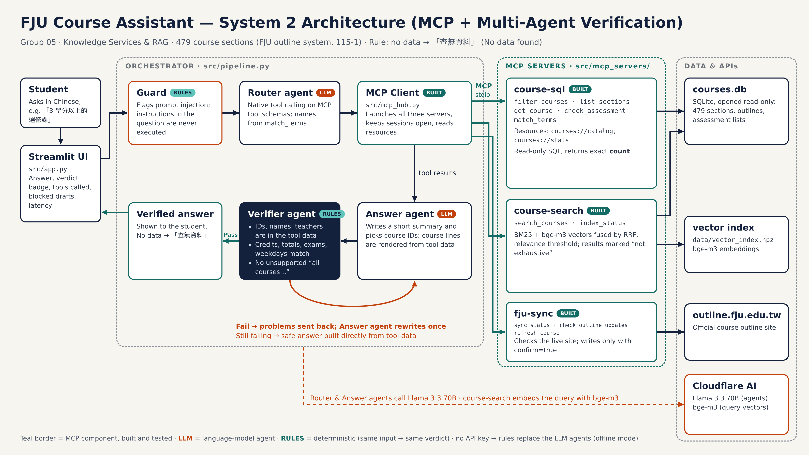

# MCP 架構說明（System 2）

System 2 把 System 1 靠「向量檢索 + LLM」硬答的部分，拆成可呼叫的 MCP 工具，再由多個 agent 分工：Router 決定查什麼、Answer 只根據工具資料寫回答、Verifier 逐句核對。英文版說明與執行方式見 `README.md`。



## 為什麼需要 MCP

System 1 的失敗（詳見 `VERIFICATION_LOG.md`）多半是結構化問題交給語意檢索：

| 失敗 | 原因 | System 2 的對策 |
|---|---|---|
| 「3 學分以上選修」只列幾門卻當成全部 | 向量檢索只取 top-5 | SQL 篩選，回傳**符合總門數**供核對 |
| 「沒有期末考的課」4 門裡 3 門答錯 | LLM 憑片段推測 | 依官方「學習評量」清單查詢，並標明判斷依據 |
| 沒資料也編造答案 | 沒有放棄機制 | 查不到一律回傳「查無資料」；Verifier 攔下編造 |
| 追問時失去上下文 | 每次只送當前問題 | 記住上一輪課號，用 `get_course` 追問 |
| 同名課學分不同只答一種 | 只檢索到其中一班 | `list_sections` 列出全部班級與學分分布 |
| 提示注入 | 問題直接進 prompt | Guard 偵測；Verifier 攔下沒有資料支持的全稱說法 |

## 元件與狀態

| 元件 | 檔案 | 狀態 |
|---|---|---|
| MCP Server：course-sql | `src/mcp_servers/course_sql_server.py` | 已完成 |
| MCP Server：course-search | `src/mcp_servers/course_search_server.py` | 已完成（向量索引 479 門） |
| MCP Server：fju-sync | `src/mcp_servers/fju_sync_server.py` | 已完成：檢查資料新鮮度、與官網比對、確認後更新 |
| MCP Client | `src/mcp_hub.py` | 已完成：stdio 啟動兩個 Server、保持連線、讀取 Resource |
| Guard | `src/router_agent.py` | 已完成（規則式） |
| Router agent | `src/router_agent.py` | 已完成：LLM 原生 tool calling（工具清單＝MCP Server 宣告的 schema），參數經 match_terms 與規則校正；失敗退回規則 |
| Answer agent | `src/answer_agent.py` | 已完成：LLM 只寫摘要並挑課號，課程清單由工具資料產生；另有不用 LLM 的安全回答 |
| Verifier agent | `src/verifier.py` | 已完成（規則式，逐句比對） |
| 流程與介面 | `src/pipeline.py`、`src/app.py` | 已完成 |

## course-sql 工具與資源

| 工具 | 用途 |
|---|---|
| `filter_courses` | 依課名、老師、系所、學分範圍、必選修、星期、晚間、語言、分類、是否程式課篩選（條件以 AND 組合） |
| `list_sections` | 列出同名課的所有班級與各學分班數 |
| `get_course` | 用課號取得時間、教室、評量項目與比例、分類 |
| `check_assessment` | 依「學習評量」清單找出有／沒有某項評量（如期末考）的課 |
| `match_terms` | 從問題原文找出資料庫裡真的存在的課名、老師、系所，讓 Router 照抄（防止 LLM 把中文參數寫錯字） |

| Resource | 用途 |
|---|---|
| `courses://catalog` | 所有課名、教師、開課班級名單（Verifier 用來偵測回答中不在工具結果裡的課名、老師；Router 用來辨認班級） |
| `courses://stats` | 課程數、大綱數、學年期 |

設計原則：唯讀（SQLite `mode=ro`）；`count` 是符合條件的總門數，不受 `limit` 影響；`count=0` 時回傳 `note: "查無資料"`。

## course-search 工具

| 工具 | 用途 |
|---|---|
| `search_courses` | 描述型問題（「想學資料分析」）：BM25 關鍵字 + bge-m3 向量，以 RRF 合併；回傳 `exhaustive=false` |
| `index_status` | 向量索引涵蓋幾門課、向量搜尋是否可用 |

相關度規則：
- 短關鍵詞（≤ 3 個 bigram，例如「區塊鏈」「天文學」）必須在大綱裡整個詞出現；只在參考書目出現半個詞（「區塊鍊革命」）不算。
- 長句：完整關鍵詞出現，或 bigram 至少命中一半。排序：關鍵詞在課名 > 在大綱 > BM25 分數。
- 向量：有關鍵字命中的課，相似度 ≥ 0.55 才加分；關鍵字沒命中、只靠向量的課，長句要 ≥ 0.65，短關鍵詞一律不採用。門檻用 `python src/tune_search.py` 校正。
- 沒有 Cloudflare 憑證時自動退回純 BM25，回傳的 `mode_used` 會標示。

## fju-sync 工具

| 工具 | 用途 |
|---|---|
| `sync_status` | 課程數、學年期、資料庫與向量索引的更新時間、缺大綱的課、索引是否需要重建 |
| `check_outline_updates` | 向輔大課程大綱系統重新抓一門課，與資料庫比對（唯讀）；回傳評量清單前後差異 |
| `refresh_course` | 重新抓一門課並寫入資料庫；`confirm=true` 才寫入 |

這三個工具不給 Router 使用：學生問問題不會觸發抓取官網或寫入資料庫，只能從介面的「資料同步」區塊操作。沿用期中的爬蟲（每次請求間隔 1 秒以上）。

## Verifier 檢查項目

1. 工具查無資料 → 回答只能是「查無資料」
2. 回答中的課號必須在工具結果裡
3. 回答提到的課名、老師（比對 `courses://catalog`）必須在工具結果裡
4. 同一行的課號、學分、老師必須一致
5. 「共 N 門」必須等於工具的 `count`；搜尋結果不能寫總數
6. 「沒有期末考」「有期中考」「期中考 30%」必須與評量清單一致
7. 「所有課都不用考試」這類全稱說法必須有資料支持
8. 回答提到的上課星期必須是那門課真的有上課的日子
9. 用「」引用的名稱必須出現在工具資料或問題裡
10. 工具有資料時，回答必須引用至少一門查到的課，不能說「查無資料」（搜尋結果都不相關時例外）

不通過時，問題清單會回饋給 Answer agent 重寫一次；仍不通過就改用工具資料直接產生的安全回答。

## 執行

```bash
pip install -r requirements.txt
streamlit run src/app.py              # System 2 網頁
python src/pipeline.py "問題"          # 命令列，印出每一步
python tests/test_system2.py          # 自動測試（假 LLM，不需要 API key）
python src/eval_system2.py            # System 1 vs System 2 對照報告 → docs/eval_system2.md
python src/benchmark_system2.py       # 期中 33 題 + 5 題冷門主題 → docs/benchmark_system2.md
python src/tune_search.py             # 校正向量相似度門檻（需要 API key）
python src/demos/demo_client.py       # MCP Client 示範
python src/demos/verifier_demo.py     # Verifier 示範
```

資料庫預設為專案根目錄的 `courses.db`，可用環境變數 `COURSES_DB` 指定。

## 測試結果（479 門課）

| 問題 | 回傳 |
|---|---|
| 3 學分以上選修 | 共 90 門 |
| 1 學分的課 | 共 12 門 |
| 星期五晚上有課 | 共 25 門 |
| 資工系「程式設計概論」 | 查無資料 |
| 輔大有開量子計算的課嗎？ | 查無資料 |
| 「程式設計概論」學分 | 9 班：2 學分 2 班、3 學分 7 班 |
| 評量清單沒有期末考 | 192 門（479 門中 287 門有期末考） |
| 資工一乙的程式設計(一) → 那它在星期幾上課？ | 同一門課（743463，王國華） |

數字以 `src/eval_system2.py` 中獨立撰寫的 SQL 核對。

## 已知限制

- 「沒有期末考」是依官方評量清單判斷；清單沒列出不代表老師一定不考。
- Verifier 檢查能和資料比對的事實（課號、課名、老師、學分、總數、星期、評量、引用名稱）；不涉及這些的錯誤描述（例如編造課程內容）攔不到。
- `refresh_course` 寫入新資料後，向量索引要重新執行 `python rag_core.py build` 才會更新；`sync_status` 會提示。
