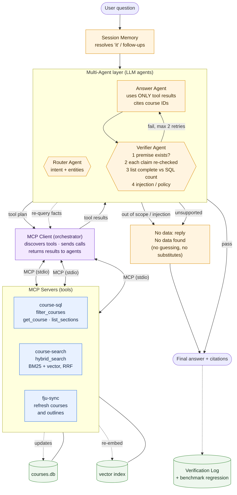

# MCP 架構說明（System 2）

System 2 把 System 1 靠「向量檢索 + LLM」硬答的部分，拆成可呼叫的工具。第一個工具是 `course-sql` MCP Server，已實作並對 479 門課的 `courses.db` 測試。

## 為什麼需要 MCP

System 1 的失敗（詳見 `VERIFICATION_LOG.md`）多半是結構化問題交給語意檢索：

| 失敗 | 原因 | System 2 的對策 |
|---|---|---|
| 「3 學分以上選修」只列幾門卻當成全部 | 向量檢索只取 top-5 | SQL 篩選，回傳**符合總門數**供核對 |
| 「沒有期末考的課」4 門裡 3 門答錯 | LLM 憑片段推測 | 依官方「學習評量」清單查詢，並標明判斷依據 |
| 沒資料也編造答案 | 沒有放棄機制 | 查不到一律回傳「查無資料」 |
| 追問時失去上下文 | 每次只送當前問題 | 用課號（`get_course`）追問，不重新文字搜尋 |
| 同名課學分不同只答一種 | 只檢索到其中一班 | `list_sections` 列出全部班級與學分分布 |

## 架構

```
使用者 → MCP Client（orchestrator）
            ├─ Router agent    判斷問題類型（結構化 / 語意 / 追問）
            ├─ MCP Server: course-sql     ← 已實作（本資料夾 mcp_server/）
            ├─ MCP Server: course-search  （規劃：BM25 + 向量 hybrid）
            ├─ MCP Server: fju-sync       （規劃：同步官網最新課程）
            ├─ Answer agent    只能根據工具回傳內容作答
            └─ Verifier agent  核對答案與工具結果；不一致或無資料 → 「查無資料」
```

通訊方式為 stdio。目前**已實作**的是 `course-sql` Server、Demo Client 與 **Verifier（最小版）**；Router / Answer agent 與另外兩個 Server 為規劃中的設計。



## course-sql 工具

| 工具 | 用途 |
|---|---|
| `filter_courses` | 依課名、老師、系所、學分範圍、必選修、星期、晚間、語言、分類、是否程式課篩選（條件以 AND 組合） |
| `list_sections` | 列出同名課的所有班級與各學分班數 |
| `get_course` | 用課號取得時間、教室、評量項目與比例、分類 |
| `check_assessment` | 依「學習評量」清單找出有／沒有某項評量（如期末考）的課 |

設計原則：
- **唯讀**：以 SQLite `mode=ro` 開啟，無法修改資料。
- **回傳總數**：`count` 是符合條件的總門數，不受 `limit` 影響，Verifier 可核對清單是否完整。
- **沒資料就說查無資料**：`count=0` 時回傳 `note: "查無資料"`，不猜測、不推薦替代課程。

## 執行

```bash
python3 -m pip install -r mcp_server/requirements.txt   # fastmcp
python3 mcp_server/demo_client.py
```

資料庫預設為專案根目錄的 `courses.db`，可用環境變數 `COURSES_DB` 指定。

## 測試結果（479 門課）

| 問題 | MCP 回傳 |
|---|---|
| 3 學分以上選修 | 90 門 |
| 1 學分的課 | 12 門 |
| 星期五晚上有課 | 25 門 |
| 資工系「程式設計概論」 | 查無資料 |
| 量子運算相關課程 | 查無資料 |
| 「程式設計概論」學分 | 9 班：2 學分 2 班、3 學分 7 班 |
| 評量清單沒有期末考 | 192 門（479 門中 287 門有期末考） |

前三項已用獨立 SQL 核對，數字一致。

## Verifier（已實作，`mcp_server/verifier.py`）

Answer agent 產生回答時同時附上結構化主張（課號、學分、老師、總數、是否有某評量），Verifier 用程式比對 MCP 工具實際回傳的資料。任何一條對不上，回答就被攔下改回「查無資料」。不使用 LLM，結果可重現。

執行 `python3 mcp_server/verifier_demo.py`，用真實工具回傳測試 5 個情境（草稿為模擬 System 1 的錯誤類型）：

| 情境 | 結果 |
|---|---|
| A. 正確回答 | 通過 |
| B. 沒資料卻編造課程 | 攔截，改回「查無資料」 |
| C. 同名課學分說錯（都是 3 學分） | 攔截，指出應為 2 |
| D. 只列 5 門卻說是全部（實際 90 門） | 攔截 |
| E. 宣稱某課沒有期末考（其實有） | 攔截，列出實際評量 |

## 已知限制

- 「沒有期末考」是依官方評量清單判斷；清單沒列出不代表老師一定不考。
- 目前只有結構化查詢工具；語意類問題（例如「適合初學者的課」）仍待 `course-search` 實作。
- Router / Answer agent 尚未實作；Verifier 的主張目前由模擬草稿提供，尚未接上真正由 LLM 產生的回答。
- Verifier 只檢查結構化主張（課號、學分、老師、總數、評量），不檢查自由文字的語意。
