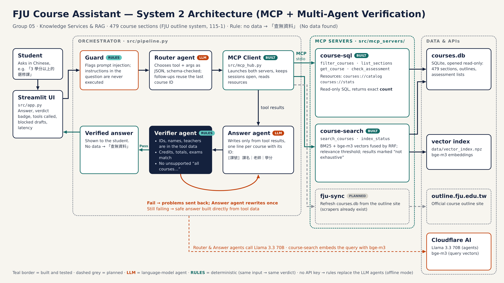

# FJU Course Assistant — Group 05

**A course-selection assistant for Fu Jen Catholic University that answers from the official course outlines, and says 「查無資料」 (No data found) instead of guessing.**

AI Language Model Integration · Final Project · Domain: Knowledge Services & RAG



## Problem and KPIs

FJU students choose courses by opening outlines one by one. Credits, time slots and grading are spread across separate pages; same-name courses have many sections with different teachers and credits (程式設計概論 has 9 sections: 7 with 3 credits, 2 with 2 credits); and everyday questions such as 「星期五晚上的課」 or 「沒有期末考的課」 cannot be typed into the official search.

**Target users:** FJU undergraduates choosing courses, especially first- and second-year students and students taking courses outside their department.

Our System 1 prototype (naive vector RAG) failed 5 of 6 test questions: it missed most matching courses, invented a make-up exam, listed other departments' sections as if they were the CS department's, and lost track of follow-up questions. See [VERIFICATION_LOG.md](VERIFICATION_LOG.md).

| # | KPI | System 1 (naive RAG) | System 2 target | How we measure |
|---|---|---|---|---|
| 1 | Filter questions answered with the exact total | 1 of 7 electives found (14%) | 100% | `src/eval_system2.py` vs independent SQL |
| 2 | Honest refusal when the data has no answer | 0 of 4 said 「查無資料」 | ≥ 90% | eval cases F-03, T-07 |
| 3 | Invented or wrong facts that reach the student | Several (F-02, F-03, F-04) | 0 (blocked by Verifier) | `tests/test_system2.py`, eval |
| 4 | Follow-up questions keep the same course | Failed | Pass | eval case F-05 |
| 5 | Median response time | not measured | ≤ 10 s | latency in `src/eval_system2.py` |

Full KPI definitions: [KPI.md](KPI.md). Latest before/after results: [docs/eval_system2.md](docs/eval_system2.md).

## How System 2 works

One question passes through four agents and two MCP servers:

1. **Guard** (rules) flags prompt-injection phrases such as 「忽略之前的指示」. The question is treated as data; its instructions are never executed.
2. **Router agent** (LLM) chooses which MCP tool to call and with what arguments, as JSON that is checked against each tool's schema. A follow-up such as 「那它幾點上課？」 reuses the course ID from the previous turn. If the LLM output is invalid, rule-based routing takes over.
3. **MCP tools** return exact data:
   - `course-sql`: `filter_courses`, `list_sections`, `get_course`, `check_assessment`, plus resources `courses://catalog` and `courses://stats`. Read-only SQL; every list comes with the exact total `count`.
   - `course-search`: `search_courses` (BM25 + bge-m3 vectors fused by Reciprocal Rank Fusion, with a relevance threshold) and `index_status`. Results are marked as not exhaustive.
4. **Answer agent** (LLM) writes only from the tool results, one line per course with its ID: `[課號] 課名｜老師｜學分｜…`.
5. **Verifier agent** (rules, no LLM) checks the draft line by line against the tool results: course IDs, names and teachers must exist in the data; credits, totals and exam claims must match; sweeping claims such as 「所有課都不用考試」 must be supported. If the draft fails, the problems are sent back and the Answer agent rewrites once; if it still fails, the student gets a safe answer built directly from the tool data.

Without Cloudflare credentials, the app runs in **offline mode**: rule-based routing and answers built directly from tool data, still checked by the Verifier. This is our backup for the live demo.

## Repository layout

```
src/
  app.py                     Streamlit UI (System 2)
  pipeline.py                Orchestrator: Guard → Router → MCP tools → Answer → Verifier
  router_agent.py            Router agent + prompt-injection Guard
  answer_agent.py            Answer agent (LLM) and safe answer (no LLM)
  verifier.py                Verifier agent (rule-based)
  mcp_hub.py                 MCP client: launches servers over stdio, keeps sessions open
  llm.py                     Cloudflare Workers AI wrapper, .env loader
  eval_system2.py            System 1 vs System 2 evaluation against independent SQL
  mcp_servers/
    course_sql_server.py     MCP server: exact SQL tools + resources
    course_search_server.py  MCP server: hybrid keyword + vector search
  demos/                     Command-line demos (MCP client, Verifier)
tests/test_system2.py        Automated tests with a fake LLM (no API key needed)
docs/                        Architecture diagram (PNG + HTML source), evaluation report
app.py, rag_core.py          System 1 (naive RAG baseline, kept for comparison)
fju_list_scraper.py, fju_outline_fetcher.py   Data collection from outline.fju.edu.tw
benchmark.py, run_edge_tests.py               System 1 tests
courses.db                   479 course sections (academic year 115, semester 1)
```

## Setup and run

Requires Python 3.10 or later.

```bash
pip install -r requirements.txt
cp .env.example .env          # then fill in CF_ACCOUNT_ID and CF_API_TOKEN
                              # (skip this step to run in offline mode)
```

Run the System 2 web app:

```bash
streamlit run src/app.py      # opens http://localhost:8501
```

Other commands (run from the project root):

```bash
python src/pipeline.py "推薦 3 學分以上的選修課"   # one question, with the full trace
python tests/test_system2.py                        # 24 automated checks, no API key needed
python src/eval_system2.py                          # before/after report → docs/eval_system2.md
python src/demos/demo_client.py                     # MCP client demo
python src/demos/verifier_demo.py                   # Verifier demo with 6 faulty drafts
python rag_core.py build                            # rebuild the vector index (needs API key)
streamlit run app.py                                # System 1, for comparison
```

To use the MCP servers from another MCP client (for example Claude Desktop), point it at `python src/mcp_servers/course_sql_server.py` or `python src/mcp_servers/course_search_server.py` (stdio transport).

## Known limits

- The vector index currently covers 47 of 479 courses; run `python rag_core.py build` with an API key to rebuild it for all courses. Until then `course-search` relies mostly on BM25 keywords.
- 「沒有期末考」 is judged from the official 學習評量 list; an exam that is not listed is not proof that none exists. The tools state this basis in every answer.
- The Verifier recognises course names and teachers that exist in `courses.db`; an invented name that matches nothing in the database is caught only if it comes with a course ID or a number that can be checked.
- `fju-sync` (refreshing data from the outline site as an MCP server) is planned; the scrapers already exist.

## Team contribution

| Member | Responsibilities | Contribution |
|---|---|---|
| 林軒宏 | TBD | TBD |
| 陳沛慈 | TBD | TBD |
| 郭昭佑 | TBD | TBD |
| 張齊祐 | TBD | TBD |

## Data and credentials

- Course data comes from the public FJU course outline system (outline.fju.edu.tw). The scrapers wait at least 1 second between requests.
- Never commit `.env` or API keys; `.env` is in `.gitignore`. Use `.env.example` as the template.
- `data/` (vector index, Q&A logs) is generated locally and not committed.
